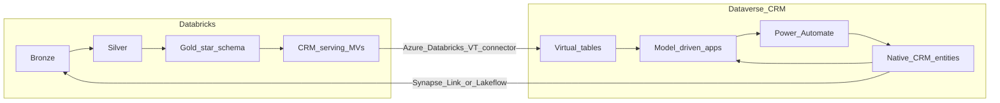

# Architecture

## Pattern

## Ownership

| Domain | Owner | Store |
|--------|--------|--------|
| Orders, items, invoices, product facts | Databricks gold | Delta / MVs |
| Accounts, contacts, opportunities, cases, activities | Dataverse | Native tables |
| Persona-ready CRM context | Databricks `crm_serve` | Materialized views |
| CRM UI / roles / flows | Power Platform | Virtual + native |

## Why not full sync

- Reuses gold without re-modeling stars in Dataverse.
- Schema evolution stays in Databricks; Dataverse only rebinds when the serving contract changes.
- Avoids Dataverse storage, sync lag, and dual-write reconciliation of large facts.
- Fits virtual-table limits (~1,000 rows per query) via pre-scoped persona marts.

## Persona strategy

- Encode persona differences as separate MVs or Unity Catalog row filters — not divergent Dataverse entity models.
- One virtual-table catalog; Dataverse security roles gate which apps/forms open which tables.
- Heavy analytics stay on Power BI / Databricks SQL over gold.

## Anti-patterns

- Copying full `fact_order` / `fact_invoice` into native Dataverse.
- Pointing virtual tables at raw gold facts without aggregation/windowing.
- Using plain SQL views as VT sources (unsupported; use MVs/tables).
- Writing order/invoice corrections from CRM into Databricks (out of scope).
- Large unfiltered RetrieveMultiple against virtual tables in apps/flows.

## Relationship constraint

Virtual tables cannot sit on the **1-side** of a 1:N relationship. Keep Account (native) on the 1-side; filter virtual order/invoice rows by the Account business key (`new_erp_customer_id`).
