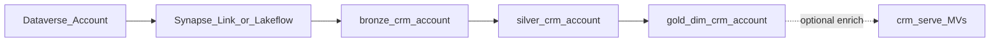

# Dataverse → Databricks ingest

Bring CRM Account (and related) attributes into the lake so gold / `crm_serve` can enrich context. **Does not** change Databricks as SoT for orders/items/invoices.

## Recommended path

Prefer a managed export:

1. **Azure Synapse Link for Dataverse** (or Link to Fabric) exporting Account (and optional Contact/Opportunity) to ADLS Gen2 in Delta/CDM, **or**
2. **Databricks Lakeflow Connect for Dynamics 365 / Dataverse** when available in your workspace.

Then land into medallion layers as below.

## Layer contracts

| Layer | Table | Responsibility |
|-------|-------|----------------|
| Bronze | `bronze.crm_account_raw` | Exact export payload; append or replace per link mode |
| Silver | `silver.crm_account` | Typed, deduped latest-per-`accountid`, trimmed keys |
| Gold | `gold.dim_crm_account` | Business-key grain (`customer_id` = Account.`new_erp_customer_id`) |

SQL:

- [sql/01_bronze_crm_account.sql](sql/01_bronze_crm_account.sql)
- [sql/02_silver_crm_account.sql](sql/02_silver_crm_account.sql)
- [sql/03_merge_dim_crm_account.sql](sql/03_merge_dim_crm_account.sql)

Gold DDL lives in [../sql/07_dim_crm_account.sql](../sql/07_dim_crm_account.sql).

## SLA

| Step | Target |
|------|--------|
| Synapse Link / Lakeflow lag | Near-real-time to ~15 min (service-dependent) |
| Bronze → silver → gold job | ≤ 1 hour |
| Visible in `crm_serve` enrichment | ≤ 4 hours after Dataverse change (matches CONTRACT) |

## Setup checklist

1. Enable change tracking / Synapse Link tables: `account` (required), optionally `systemuser` for owner names.
2. Ensure Account has `new_erp_customer_id` populated for rows that should join to gold customers.
3. Point bronze external/location or Lakeflow target at `${catalog}.bronze`.
4. Schedule silver+gold notebook/SQL job after bronze updates.
5. Validate with orphan queries in [../dataverse/account_bridge_field.md](../dataverse/account_bridge_field.md).

## Out of scope

- Writing order/invoice corrections from Dataverse into gold facts.
- Using Dataverse as a warehouse for historical commerce facts.
